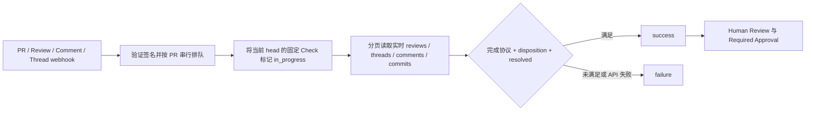

# AI Review / Disposition Check

目标：配置的 AI Bot 和 PR 作者之外的人工 reviewer 提出的行内意见都有可审计的处理记录，并且对话已 Resolve。检查不要求采纳审查建议，也不代替 Human Review。

本仓库提供 [Python 检查器](../scripts/check_ai_review_disposition.py)、[reusable workflow](../.github/workflows/reusable-ai-review-disposition.yml) 和两个项目接入示例。规则单独运行，不并入现有 `CI Result`：代码 CI 与 review 的完成时间不同，回复评论也不应该重新运行测试。

每次只检查明确指定的一个 PR，只更新该 PR 最新提交上的 Check。其他 open PR 不参与本次判定；closed/merged PR 直接跳过。当前 API 客户端仅支持 GitHub.com。

## 合并条件

```text
每个指定 AI Bot 已完成当前 head SHA 的 review
AND 每个纳入范围的 AI / 人工行内意见有授权人员的有效 disposition
AND 每个 finding 的 conversation 已 Resolve
```

检查范围为配置的 Bot，以及 PR 作者之外的人工 reviewer 创建的所有已发布 inline review threads，包括历史提交上的 outdated threads 和已 Resolve 的 threads。每个 thread 是一条 finding，不同问题应分成不同 threads；AI 和人工意见共用以下模板、证据、回复权限和 Resolve 要求。PR 作者自行创建的人工 thread、未配置的 GitHub Bot thread、PR 顶层普通评论和 Review 总评不计为 finding。尚未提交的 pending review 不计入已发布 findings。

Bot 由精确 GitHub login 匹配，例如 `reviewer[bot]`；不根据显示名、正文或模糊子串识别。GraphQL 的 `Bot` 类型若返回不带后缀的 login，会转换成标准 `[bot]` 格式；普通 `User` 不做此转换。配置的 Bot 优先按 AI 处理，即使其账号类型是 `User`（如 `infiscale-bot`）或恰好是 PR 作者。其他 `User` 按人工账号处理。`AI_REVIEW_BOTS` 中的每个 Bot 都必须完成 review；人工 reviewer 不需要完成标记。空配置是错误，不会当作“无 AI 问题”通过。本次只扩展意见范围，未修改 AI Bot 完成协议。

回复者必须是 PR 作者或当前拥有仓库 `write` / `maintain` / `admin` 权限的人员。其他人员的回复不生效；GitHub Bot 和已配置的 AI 服务账号不能自行 disposition。仅有组织成员身份不足以授权回复。

| Disposition | 必须提供的字段 | 检查的证据 |
| --- | --- | --- |
| Accepted | `Reason`、`Fix` | 完整的 40 位 commit SHA，或当前仓库的标准 commit 链接；提交必须仍在当前 PR 的 commits 中 |
| Rejected | `Reason` | 非空拒绝理由 |
| Invalid | `Reason` | 非空误报理由 |
| Deferred | `Reason`、`Tracking` | GitHub API 确认存在、当前 token 可读且仍开放的 Issue，不能是 PR |

`Fix` 证明提交引用有效；工具不判断该提交是否真正修复问题。理由的充分性、跟踪 Issue 是否确实覆盖此条意见，以及 deferral 的业务可接受性由 Human Review 审查。当前版本不支持无 tracking 的口头豁免；若未来接入审批，应验证审批人的身份及审批记录，而不是接受 Contributor 自填 `Approved: yes`。

## Contributor 回复格式

直接在对应 inline thread 中回复。第一行必须是 `Disposition: ...`，每个字段单独一行；允许空行和字段名/状态大小写变化。不要加引号、Markdown 引用、代码块或额外字段。`Reason` 保持一行，可以用中文。

Accepted：

```text
Disposition: Accepted
Reason: 已补充空数组边界判断，并增加回归测试。
Fix: https://github.com/IS-Model-Framework/example/commit/0123456789abcdef0123456789abcdef01234567
```

`Fix` 兼容直接填写完整 40 位 SHA。链接仅支持 `https://github.com/owner/repo/commit/<完整40位SHA>`，仓库必须与当前 PR 所在仓库一致；不接受短 SHA、其他站点或仓库、PR 链接、查询参数和锚点。链接提取 SHA 后复用现有 PR 提交列表校验，不增加 API 请求。实际回复作为普通文本发送，不要包在代码块里，commit 链接即可点击跳转；延期 Issue 链接仍填写在 `Tracking` 字段中。

Rejected：

```text
Disposition: Rejected
Reason: 调用入口已验证该条件，此处不会收到负数输入。
```

Invalid：

```text
Disposition: Invalid
Reason: 此实现使用异步执行，评论所述的同步调用路径不存在。
```

Deferred：

```text
Disposition: Deferred
Reason: 本次先完成兼容修复，性能优化在后续版本处理。
Tracking: https://github.com/IS-Model-Framework/example/issues/42
```

`Tracking` 只接受 `https://github.com/owner/repo/issues/number` 形式的完整 Issue 链接，不接受其他站点、裸编号、PR 链接、查询参数或锚点。检查器会实际调用 GitHub Issues API；不存在、已关闭、无法读取的 Issue，以及限流、鉴权或服务错误都不会通过。允许引用其他仓库的 Issue，但当前 token 必须能读取；其他仓库的私有 Issue 可能需要 GitHub App installation token。

采用最新编辑时间的明确 disposition 回复；同一时间取 thread 中更后的回复。新的不完整 disposition 会替代旧的有效回复，避免沿用过期决定。普通交流回复不会替代 disposition。人工线程只在原始审查意见的编辑时间晚于模板回复时要求重新确认；reviewer 后续追加“好的”“谢谢”或普通讨论不会使已有模板失效。新问题应新开线程或编辑原始意见。AI 线程仍按原有规则处理 AI 的编辑和追加回复，AI 完成协议不变；人工 reviewer 不需要完成标记。修复提交被 force-push 移出 PR 后，Accepted 的 SHA 和链接两种格式都失效。

有效回复之后，由 Contributor / Maintainer Resolve Conversation；工具不会自动 Resolve。只 Resolve、只写 “done / 已修复”、在 PR 总结里统一回答，都不能通过。

## AI Bot 完成协议

Bot 的 review 流程必须遵守：

1. 对固定的 PR head SHA 生成 findings，用 inline threads 发布。
2. 全部 findings 发布完毕后，提交一个非 pending 的 review，其正文包含独立一行：

   ```text
   AI-Review-Complete: <当前 PR 的完整 head SHA>
   ```

3. review 本身的 `commit.oid` 也必须等于该 SHA。没有 findings 时仍需要这个 review；这样“零问题”和“尚未开始 review”不会混淆。
4. 当前 head 改变后，重新 review 并提交新完成标记。后续提交的新 review 未含标记、review 被 dismissed，或者 Bot 在完成标记之后继续增加/编辑 finding，均阻断通过。

这是本工具的集成协议，不是 GitHub 自带的字段。现有 Bot 若不能提供该标记，需要修改其发布流程；不能仅凭 “没有 unresolved threads” 推断 review 已完成。不要在 findings 尚未全部发布时写入完成标记。

## Actions 接入

`.github` 仓库的 workflow 不会自动在所有组织项目执行。每个目标项目需要 caller workflow，并由组织 ruleset 覆盖目标仓库。

1. 将 [ai-review-events.yml](examples/ai-review-events.yml) 与 [ai-review-disposition.yml](examples/ai-review-disposition.yml) 配套复制到目标项目 `.github/workflows/`，合入默认分支。collector 的 `run-name` 必须保持为 PR 编号，供后续 `workflow_run` 定位目标；不要改成 PR 标题。迁移期间旧 collector 的历史运行不符合新格式，可通过手动指定 PR 复查。
2. 在组织/仓库 Variables 设置 `AI_REVIEW_BOTS` 为准确的 login 列表，逗号分隔。示例中的 Bot 名称不是实际默认配置。
3. 生产环境将 caller 的 `uses: ...@main` 与 `shared-ref: main` 同时固定到本仓库同一个已审核 commit SHA。共享脚本从可信 CI 仓库加载，完全不 checkout PR 代码。
4. 为 `GITHUB_TOKEN` 提供 `contents: read`、`pull-requests: read`、`issues: read`、`checks: write`。如果组织 CI 仓库是 private，还需要开启 reusable workflow 的组织访问，并通过可选 secret `shared-read-token` 提供 CI 仓库的只读 checkout token；caller 的 `GITHUB_TOKEN` 不会自动获得其他 private 仓库的读取权限。
5. 完成一次运行后，将 **`AI Review / Disposition Check`** 加入 ruleset 的 Required Status Checks，检查来源选择 GitHub Actions。保持现有 Human Review / approval 规则。

选择的是脚本通过 Checks API 发布到 PR **head commit** 上的 Check，不是 `Evaluate AI Review Dispositions` 这个 Actions job。`pull_request_target`、`issue_comment`、`workflow_run` 的 `GITHUB_SHA` 不一定是 PR head；直接使用 job success 作合并门禁会关联到错误提交。

| 事件 | 示例中的路径 |
| --- | --- |
| PR opened / reopened / synchronize / ready_for_review | 从 `pull_request.number` 取得编号，只检查该 PR |
| Review submitted / edited / dismissed | 无权限的 collector 把 PR 编号写入 `run-name` → 默认分支 `workflow_run.display_title` → 检查该 PR |
| Inline comment created / edited / deleted | 同上 |
| PR 顶层评论 created / edited / deleted | `issue_comment` 触发复查，可用一条 “AI review recheck” 评论重新计算 |
| Resolve / Unresolve | Actions 不直接支持此事件；手动复查、顶层评论，或 App webhook → `repository_dispatch` |
| Bot 用 `GITHUB_TOKEN` 发布 review/comments | 通常不会触发后续 Actions；review workflow 结束后显式复查，或改用 App token 发布 |
| Actions 手动运行 | 必填 `pr-number`，只检查指定 PR |
| `repository_dispatch: ai-review-state-changed` | 在 `client_payload.pr_number` 中传入目标 PR 的正整数编号 |

collector 不检出或执行 PR 内容、不上传 artifact。caller 对 `workflow_run.display_title` 使用 `fromJSON` 取得数字编号，因此 fork 的 `workflow_run.pull_requests` 为空也能定位。这个编号只用作路由提示，不接受 collector 提供的审查结论或脚本；有写权限的检查器始终从可信共享仓库加载，重新读取目标仓库中该 PR 的实时 API 数据。

调用方和 CLI 都要求显式传入正整数 PR 编号；缺失、0、负数或非法值报错，不回退到全仓库扫描。权限检查与 disposition 规则保持不变。

并发组包含仓库名和 PR 编号，`cancel-in-progress: false`。同一 PR 的检查串行运行，待执行事件即使被后来的事件替换，也会重新读取同一 PR 的实时状态；不同 PR 不共用队列。通过之前再完整读取一次 review 数据，发现提交或评论变化就失败。检查过程内的 API 错误会尝试写 failure；创建/更新 Check 请求本身失败、超时或取消可能留下 in-progress Check，仍然阻止合并。

手动复查可在 Actions 页面运行 `AI Review Disposition` 并填写 `pr-number`。CLI 示例：

```bash
GH_TOKEN="<token>" python scripts/check_ai_review_disposition.py \
  --repository IS-Model-Framework/example \
  --pr-number 128 \
  --bots 'reviewer[bot]'
```

这条命令会通过 Checks API 写入指定 PR 的 Check，不是 dry-run。Token 通过环境变量提供；不应提交到仓库。`--pr-number` 必填且必须大于 0。退出码：0 目标 PR 通过或已关闭而跳过，1 目标 PR 不通过（包括检查过程中捕获的 API 错误），2 参数错误或未捕获的执行错误。

## 严格组织门禁：GitHub App

Actions 方案适合初期接入，但不保证评论变化后瞬间撤销 success：事件排队、运行延迟、Resolve/Unresolve 缺少原生 trigger，都会留下状态更新窗口。需要严格覆盖 thread 状态变化时，建议组织安装专用 GitHub App，用同一个检查器作为执行核心：



App 应订阅 `pull_request`、`pull_request_review`、`pull_request_review_comment`、`pull_request_review_thread` 的相关 actions，并支持 Check rerequest；用 webhook signature 与 delivery ID 校验/去重，每个 PR 串行更新同一个 head 的 Check，变化时立即撤销旧 success。重试失败保持阻断，并以定期 reconciliation 恢复漏发/丢失事件。

权限为 Pull requests read、Contents read、Issues read、Checks write；安装 token 只覆盖获授权仓库。若调用跨仓库 Issue，需要相应仓库访问权限。当前提交未包含 App 的 webhook 服务、部署或持久化账本。

GitHub 的 Status Check 仍是异步状态，无法把“读所有评论”和“执行 merge”做成一个原子事务。高要求场景还应启用分支保护的 conversation resolution，并通过受控 merge 入口在合并前再次核验。AI findings 被删除后，实时 API 不再保留它们；若要求删除也必须留痕，App 需要持久化 finding ID 与 disposition 历史。此版本不会把 API 数据当作不可删改的审计账本。

该 Check 以 PR head 为对象；当前不支持 merge queue 生成的合成 SHA。使用 merge queue 的项目需要另外设计 `merge_group` 的成员 PR 核验，不能直接沿用此 caller 作为队列 required check。

## 验证与参考

```bash
python -m unittest discover -s scripts/tests -v
```

测试覆盖 AI / 人工行内意见的处理状态、回复权限、范围排除、意见变化后的重新确认、AI 完成协议、outdated/resolved threads、force-push、分页、API 错误与读取期间新增 findings，以及单 PR CLI、拒绝缺失/非法编号、closed PR 跳过、HTTP JSON 读写和跟踪 Issue 的真实存在性校验路径。API 通过 mock 验证；仍需在目标仓库做一次真实的 Bot / Human Review → 回复 → Resolve → 复查 → Required Check 试运行。

- [GitHub Actions 事件与 fork / workflow_run 行为](https://docs.github.com/en/actions/reference/workflows-and-actions/events-that-trigger-workflows)
- [Webhook 事件：pull_request_review_thread](https://docs.github.com/en/webhooks/webhook-events-and-payloads#pull_request_review_thread)
- [Checks API：发布并更新 Check Runs](https://docs.github.com/en/rest/checks/runs)
- [Reusable workflows 的组织接入与权限](https://docs.github.com/en/actions/how-tos/reuse-automations/reuse-workflows)
