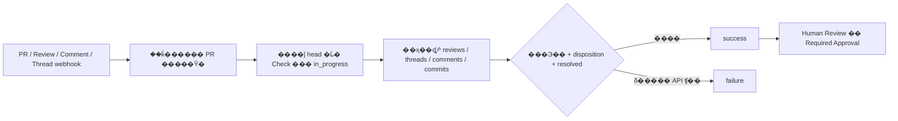

# AI Review / Disposition Check

Ŀ�꣺������Ҫ��Ӧ�� AI inline findings ���п���ƵĴ�����¼�����ҶԻ��� Resolve����鲻Ҫ����� AI ���飬Ҳ������ Human Review��

���ֿ��ṩ [Python �����](../scripts/check_ai_review_disposition.py)��[reusable workflow](../.github/workflows/reusable-ai-review-disposition.yml) ��������Ŀ����ʾ�������򵥶����У����������� `CI Result`������ CI �� review �����ʱ�䲻ͬ���ظ�����Ҳ��Ӧ���������в��ԡ�

ÿ��ֻ�����ȷָ����һ�� PR��ֻ���¸� PR �����ύ�ϵ� Check������ open PR �����뱾���ж���closed/merged PR ֱ����������ǰ API �ͻ��˽�֧�� GitHub.com��

## �ϲ�����

```text
ÿ��ָ�� AI Bot ����ɵ�ǰ head SHA �� review
AND ÿ�� AI finding ����Ȩ��Ա����Ч disposition
AND ÿ�� finding �� conversation �� Resolve
```

��鷶ΧΪ���õ� Bot �����������ѷ��� inline review threads��������ʷ�ύ�ϵ� outdated threads ���� Resolve �� threads��ÿ�� thread ��һ�� finding��Bot Ӧ�Ѳ�ͬ����ֳɲ�ͬ threads�����������ۿ�ͷ�� thread �����룬PR ��������/�ܽ�Ҳ����Ϊ finding����δ�ύ�� pending review �������ѷ��� findings��

Bot �ɾ�ȷ GitHub login ƥ�䣬���� `reviewer[bot]`����������ʾ�������Ļ�ģ���Ӵ�ʶ��GraphQL �� `Bot` ���������ز�����׺�� login����ת���ɱ�׼ `[bot]` ��ʽ����ͨ `User` ������ת����`AI_REVIEW_BOTS` �е�ÿ�� Bot ��������� review���������Ǵ��󣬲��ᵱ������ AI ���⡱ͨ����

�ظ��߱����� PR ���߻�ǰӵ�вֿ� `write` / `maintain` / `admin` Ȩ�޵���Ա��������Ա�Ļظ�����Ч��GitHub Bot �������õ� AI �����˺Ų������� disposition��������֯��Ա���ݲ�������Ȩ�ظ���

| Disposition | �����ṩ���ֶ� | ����֤�� |
| --- | --- | --- |
| Accepted | `Reason`��`Fix` | ������ 40 λ commit SHA���������ڵ�ǰ PR �� commits �� |
| Rejected | `Reason` | �ǿվܾ����� |
| Invalid | `Reason` | �ǿ������� |
| Deferred | `Reason`��`Tracking` | �����ҿ��ŵ� GitHub Issue����ָ�� Jira �����µ� ticket URL |

`Fix` ֤���ύ������Ч�����߲��жϸ��ύ�Ƿ������޸����⡣���ɵij���ԡ�Jira ticket �Ĵ�����״̬���Լ� deferral ��ҵ��ɽ������� Human Review ��顣��ǰ�汾��֧���� tracking �Ŀ�ͷ���⣻��δ������������Ӧ��֤�����˵����ݼ�������¼�������ǽ��� Contributor ���� `Approved: yes`��

## Contributor �ظ���ʽ

ֱ���ڶ�Ӧ inline thread �лظ�����һ�б����� `Disposition: ...`��ÿ���ֶε���һ�У��������к��ֶ���/״̬��Сд�仯����Ҫ�����š�Markdown ���á�����������ֶΡ�`Reason` ����һ�У����������ġ�

Accepted��

```text
Disposition: Accepted
Reason: �Ѳ��������߽��жϣ������ӻع���ԡ�
Fix: 0123456789abcdef0123456789abcdef01234567
```

Rejected��

```text
Disposition: Rejected
Reason: �����������֤���������˴������յ��������롣
```

Invalid��

```text
Disposition: Invalid
Reason: ��ʵ��ʹ���첽ִ�У�����������ͬ������·�������ڡ�
```

Deferred��

```text
Disposition: Deferred
Reason: ��������ɼ����޸��������Ż��ں����汾������
Tracking: https://github.com/IS-Model-Framework/example/issues/42
```

���� `AI_REVIEW_JIRA_URL=https://example.atlassian.net` ��Ҳ���� `Tracking: https://example.atlassian.net/browse/PROJ-123`������������ HTTPS ���ӡ��� ticket ��Ż� PR ���ӡ�GitHub Issue ��Ҫ��ǰ token �ɶ�ȡ�������ֿ��˽�� Issue ������Ҫ GitHub App installation token��

�������±༭ʱ�����ȷ disposition �ظ���ͬһʱ��ȡ thread �и���Ļظ����µIJ����� disposition ������ɵ���Ч�ظ����������ù��ھ�������ͨ�����ظ�������� disposition��AI �༭ finding ��׷�� inline �ظ�����Ҫ����ȷ�� disposition���������ύ��� review �ı�ǡ��޸��ύ�� force-push �Ƴ� PR ��Accepted ʧЧ��

��Ч�ظ�֮���� Contributor / Maintainer Resolve Conversation�����߲����Զ� Resolve��ֻ Resolve��ֻд ��done / ���޸������� PR �ܽ���ͳһ�ش𣬶�����ͨ����

## AI Bot �����

Bot �� review ���̱������أ�

1. �Թ̶��� PR head SHA ���� findings���� inline threads ������
2. ȫ�� findings ������Ϻ��ύһ���� pending �� review�������İ�������һ�У�

   ```text
   AI-Review-Complete: <��ǰ PR ������ head SHA>
   ```

3. review ������ `commit.oid` Ҳ������ڸ� SHA��û�� findings ʱ����Ҫ��� review�������������⡱�͡���δ��ʼ review�����������
4. ��ǰ head �ı������ review ���ύ����ɱ�ǡ������ύ���� review δ����ǡ�review �� dismissed������ Bot ����ɱ��֮���������/�༭ finding�������ͨ����

���DZ����ߵļ���Э�飬���� GitHub �Դ����ֶΡ����� Bot �������ṩ�ñ�ǣ���Ҫ�޸��䷢�����̣����ܽ�ƾ ��û�� unresolved threads�� �ƶ� review ����ɡ���Ҫ�� findings ��δȫ������ʱд����ɱ�ǡ�

## Actions ����

`.github` �ֿ�� workflow �����Զ���������֯��Ŀִ�С�ÿ��Ŀ����Ŀ��Ҫ caller workflow��������֯ ruleset ����Ŀ��ֿ⡣

1. �� [ai-review-events.yml](examples/ai-review-events.yml) �� [ai-review-disposition.yml](examples/ai-review-disposition.yml) ���׸��Ƶ�Ŀ����Ŀ `.github/workflows/`������Ĭ�Ϸ�֧��collector �� `run-name` ���뱣��Ϊ PR ��ţ������� `workflow_run` ��λĿ�ꣻ��Ҫ�ij� PR ���⡣Ǩ���ڼ�� collector ����ʷ���в������¸�ʽ����ͨ���ֶ�ָ�� PR ���顣
2. ����֯/�ֿ� Variables ���� `AI_REVIEW_BOTS` Ϊ׼ȷ�� login �б������ŷָ�����Ҫ Jira ʱ���� `AI_REVIEW_JIRA_URL`��ʾ���е� Bot ���Ʋ���ʵ��Ĭ�����á�
3. ���������� caller �� `uses: ...@main` �� `shared-ref: main` ͬʱ�̶������ֿ�ͬһ������� commit SHA�������ű��ӿ��� CI �ֿ���أ���ȫ�� checkout PR ���롣
4. Ϊ `GITHUB_TOKEN` �ṩ `contents: read`��`pull-requests: read`��`issues: read`��`checks: write`�������֯ CI �ֿ��� private������Ҫ���� reusable workflow ����֯���ʣ���ͨ����ѡ secret `shared-read-token` �ṩ CI �ֿ��ֻ�� checkout token��caller �� `GITHUB_TOKEN` �����Զ�������� private �ֿ�Ķ�ȡȨ�ޡ�
5. ���һ�����к󣬽� **`AI Review / Disposition Check`** ���� ruleset �� Required Status Checks�������Դѡ�� GitHub Actions���������� Human Review / approval ����

ѡ����ǽű�ͨ�� Checks API ������ PR **head commit** �ϵ� Check������ `Evaluate AI Review Dispositions` ��� Actions job��`pull_request_target`��`issue_comment`��`workflow_run` �� `GITHUB_SHA` ��һ���� PR head��ֱ��ʹ�� job success ���ϲ��Ž�������������ύ��

| �¼� | ʾ���е�·�� |
| --- | --- |
| PR opened / reopened / synchronize / ready_for_review | �� `pull_request.number` ȡ�ñ�ţ�ֻ���� PR |
| Review submitted / edited / dismissed | ��Ȩ�޵� collector �� PR ���д�� `run-name` �� Ĭ�Ϸ�֧ `workflow_run.display_title` �� ���� PR |
| Inline comment created / edited / deleted | ͬ�� |
| PR �������� created / edited / deleted | `issue_comment` �������飬����һ�� ��AI review recheck�� �������¼��� |
| Resolve / Unresolve | Actions ��ֱ��֧�ִ��¼����ֶ����顢�������ۣ��� App webhook �� `repository_dispatch` |
| Bot �� `GITHUB_TOKEN` ���� review/comments | ͨ�����ᴥ������ Actions��review workflow ��������ʽ���飬����� App token ���� |
| Actions �ֶ����� | ���� `pr-number`��ֻ���ָ�� PR |
| `repository_dispatch: ai-review-state-changed` | �� `client_payload.pr_number` �д���Ŀ�� PR ����������� |

collector �������ִ�� PR ���ݡ����ϴ� artifact��caller �� `workflow_run.display_title` ʹ�� `fromJSON` ȡ�����ֱ�ţ���� fork �� `workflow_run.pull_requests` Ϊ��Ҳ�ܶ�λ��������ֻ����·����ʾ�������� collector �ṩ�������ۻ�ű�����дȨ�޵ļ����ʼ�մӿ��Ź����ֿ���أ����¶�ȡĿ��ֿ��и� PR ��ʵʱ API ���ݡ�

���÷��� CLI ��Ҫ����ʽ���������� PR ��ţ�ȱʧ��0��������Ƿ�ֵ�����������˵�ȫ�ֿ�ɨ�衣Ȩ�޼���� disposition ���򱣳ֲ��䡣

����������ֿ����� PR ��ţ�`cancel-in-progress: false`��ͬһ PR �ļ�鴮�����У���ִ���¼���ʹ���������¼��滻��Ҳ�����¶�ȡͬһ PR ��ʵʱ״̬����ͬ PR �����ö��С�ͨ��֮ǰ��������ȡһ�� review ���ݣ������ύ�����۱仯��ʧ�ܡ��������ڵ� API ����᳢��д failure������/���� Check ������ʧ�ܡ���ʱ��ȡ���������� in-progress Check����Ȼ��ֹ�ϲ���

�ֶ�������� Actions ҳ������ `AI Review Disposition` ����д `pr-number`��CLI ʾ����

```bash
GH_TOKEN="<token>" python scripts/check_ai_review_disposition.py \
  --repository IS-Model-Framework/example \
  --pr-number 128 \
  --bots 'reviewer[bot]'
```

���������ͨ�� Checks API д��ָ�� PR �� Check������ dry-run��Token ͨ�����������ṩ����Ӧ�ύ���ֿ⡣`--pr-number` �����ұ������ 0���˳��룺0 Ŀ�� PR ͨ�����ѹرն�������1 Ŀ�� PR ��ͨ���������������в���� API ���󣩣�2 ���������δ�����ִ�д���

## �ϸ���֯�Ž���GitHub App

Actions �����ʺϳ��ڽ��룬������֤���۱仯��˲�䳷�� success���¼��Ŷӡ������ӳ١�Resolve/Unresolve ȱ��ԭ�� trigger����������״̬���´��ڡ���Ҫ�ϸ񸲸� thread ״̬�仯ʱ��������֯��װר�� GitHub App����ͬһ���������Ϊִ�к��ģ�



App Ӧ���� `pull_request`��`pull_request_review`��`pull_request_review_comment`��`pull_request_review_thread` ����� actions����֧�� Check rerequest���� webhook signature �� delivery ID У��/ȥ�أ�ÿ�� PR ���и���ͬһ�� head �� Check���仯ʱ���������� success������ʧ�ܱ�����ϣ����Զ��� reconciliation �ָ�©��/��ʧ�¼���

Ȩ��Ϊ Pull requests read��Contents read��Issues read��Checks write����װ token ֻ���ǻ���Ȩ�ֿ⡣�����ÿ�ֿ� Issue����Ҫ��Ӧ�ֿ����Ȩ�ޡ���ǰ�ύδ���� App �� webhook ���񡢲����־û��˱���

GitHub �� Status Check �����첽״̬���޷��ѡ����������ۡ��͡�ִ�� merge������һ��ԭ�����񡣸�Ҫ�󳡾���Ӧ���÷�֧������ conversation resolution����ͨ���ܿ� merge ����ںϲ�ǰ�ٴκ��顣AI findings ��ɾ����ʵʱ API ���ٱ������ǣ���Ҫ��ɾ��Ҳ�������ۣ�App ��Ҫ�־û� finding ID �� disposition ��ʷ���˰汾����� API ���ݵ�������ɾ�ĵ�����˱���

�� Check �� PR head Ϊ���󣻵�ǰ��֧�� merge queue ���ɵĺϳ� SHA��ʹ�� merge queue ����Ŀ��Ҫ������� `merge_group` �ij�Ա PR ���飬����ֱ�����ô� caller ��Ϊ���� required check��

## ��֤��ο�

```bash
python -m unittest discover -s scripts/tests -v
```

���Ը��Ǵ���״̬���ظ�Ȩ�ޡ����Э�顢outdated/resolved threads��force-push����ҳ��API �������ȡ�ڼ����� findings���Լ��� PR CLI���ܾ�ȱʧ/�Ƿ���š�closed PR ������ HTTP JSON ��д��API ͨ�� mock ��֤��������Ŀ��ֿ���һ����ʵ�� Bot Review �� �ظ� �� Resolve �� ���� �� Required Check �����С�

- [GitHub Actions �¼��� fork / workflow_run ��Ϊ](https://docs.github.com/en/actions/reference/workflows-and-actions/events-that-trigger-workflows)
- [Webhook �¼���pull_request_review_thread](https://docs.github.com/en/webhooks/webhook-events-and-payloads#pull_request_review_thread)
- [Checks API������������ Check Runs](https://docs.github.com/en/rest/checks/runs)
- [Reusable workflows ����֯������Ȩ��](https://docs.github.com/en/actions/how-tos/reuse-automations/reuse-workflows)
